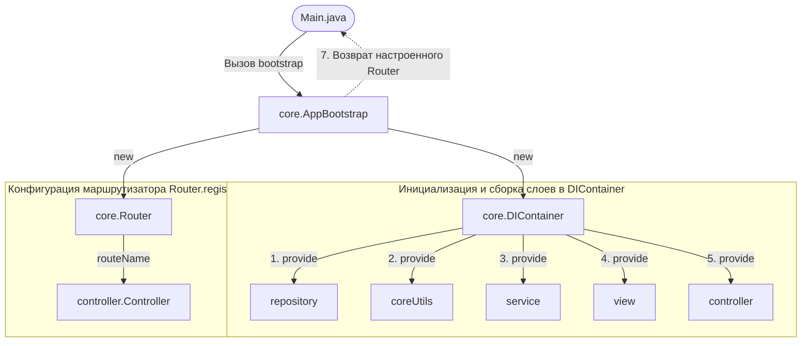
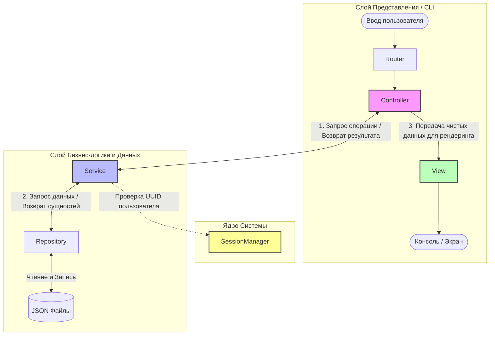

# Приложение «Личные Финансы» (Personal Finance CLI)

Итоговый проект (сессионное задание). Принципы объектно-ориентированного программирования

---

## Архитектура приложения

Проект спроектирован с упором на принципы **SOLID**, **слабую связанность** и явное разделение ответственности. 
В основе лежит **многослойная архитектура**

### Компоненты архитектуры:
*   **Слой Модели:** Инкапсулирует бизнес-правила системы (`service`) и логику персистентности данных (`repository`). Сервисы изолированы от консольного вывода и оперируют чистыми данными.
*   **Слой Представления:** Разделен на два класса:
    *   `Controller` — управляет логикой выполнения команд, координирует потоки данных между сервисами и выводом.
    *   `View` — «глупый» компонент, отвечающий исключительно за форматирование текста, построение таблиц и вывод информации на экран.
*   **Инфраструктурное Ядро (`core`):** Содержит IoC-контейнер, маршрутизатор и менеджер сессий.

---

## Диаграммы взаимодействия

### 1. Инициализация приложения
Схема показывает, как приложение запускается, изолированно собирает все слои через `DIContainer` и настраивает маршруты без использования жестких связей:



### 2. Поток данных при выполнении команд
Схема демонстрирует совместную работу всех слоев системы при обработке пользовательского ввода:



---

## Структура пакетов проекта

Архитектурные слои физически разложены по следующим пакетам в директории `src/main/java/mephi/`:

```text
└── mephi
    ├── controller
    ├── core
    ├── dto
    │   ├── request
    │   └── response
    ├── exception
    ├── Main.java
    ├── model
    │   ├── enums
    ├── repository
    ├── service
    ├── util
    └── view
```

---

## 🛠️ Технологический стек
*   **Язык:** Java 17+
*   **Сериализация:** Google Gson (работа с файловой БД в формате JSON)
*   **Форматированные таблицы** Ascii-table
*   **Сборка проекта:** Maven
*   **Визуализация архитектуры:** Mermaid.js (интегрировано в GitHub Markdown)
